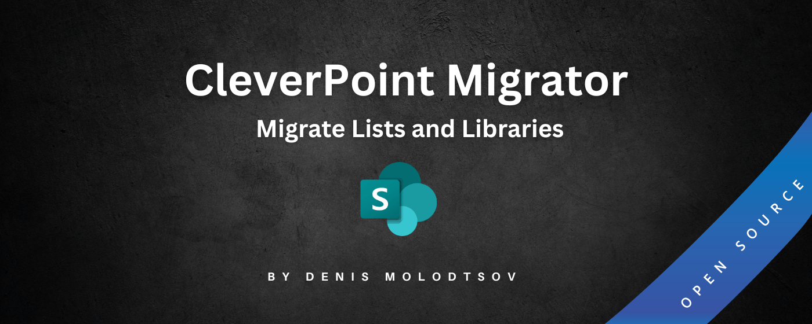
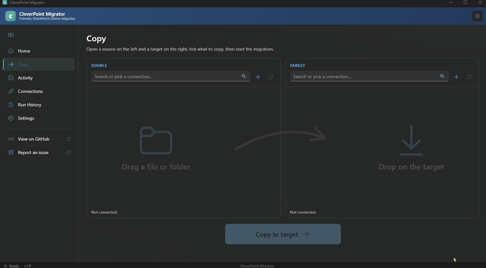
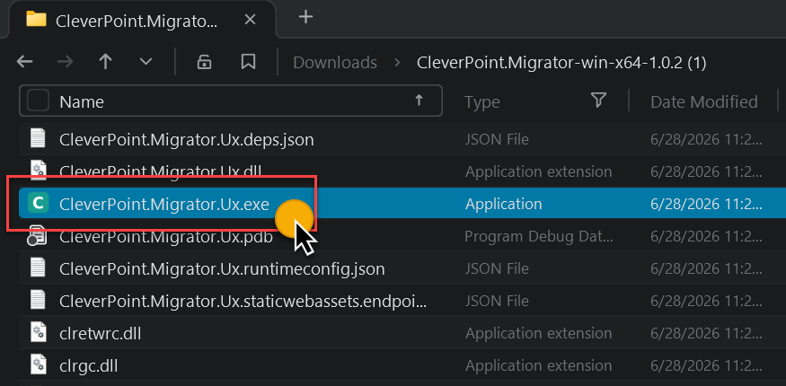

# CleverPoint Migrator

[](https://dotnet.microsoft.com/)
[](https://www.microsoft.com/microsoft-365/sharepoint/collaboration)
[](https://www.microsoft.com/windows)
[](#)
[](#)
[](LICENSE)

CleverPoint Migrator is a tool that can be used by office workers and power users to migrate large amounts of files between SharePoint Online sites. No Azure app registration is required, and the tool can be used by anyone with access to the source and destination sites. The tool is designed to be easy to use, with a simple user interface that allows users to select the source and destination sites, as well as the files to be migrated.



See the animation below for a quick demo of how to use the tool.



## Download and run

- Navigate to https://github.com/Zerg00s/CleverPoint-Migrator/releases/latest
- download and install `CleverPoint.Migrator-*.msi`
- Run `CleverPoint Migrator`

### Portable version

- download and unzip `CleverPoint.Migrator-win-x64-*.zip`
- Run `CleverPoint.Migrator.Ux.exe`



## Signing in

There are three ways to connect to a site. Pick one per connection under **Connections > Add connection**.

| Sign-in | Needs an app registration | What it can reach | Good for |
|---|---|---|---|
| Browser sign-in | No | What you can reach | Quick, one-off copies. Windows only, and you sign in again after 18 hours. |
| Microsoft sign-in | Yes, set up once per tenant by an administrator | What you can reach | Long runs. The sign-in renews by itself, also in the middle of a copy. |
| App registration + certificate | Yes | Every site in the tenant | Runs with nobody signed in. |

### Microsoft sign-in

Choose **Set up for this tenant** in the Add connection dialog. An administrator signs in, the tool registers an app called "CleverPoint Migrator" in your own tenant, and Microsoft's approval page opens for the administrator to accept. If the app already exists, it is found and reused, so the setup can be repeated safely from any computer.

The app asks for two delegated SharePoint permissions:

| Permission | Why |
|---|---|
| `AllSites.FullControl` | Copying permissions and list settings needs it. |
| `TermStore.ReadWrite.All` | Copying managed metadata terms needs it. |

Delegated means the app can never do more than the person signed in. It has no secret and no certificate. It does not use Microsoft Graph permissions.

The setup needs a Global Administrator, Privileged Role Administrator, Cloud Application Administrator or Application Administrator. Everyone else signs in with their own account afterwards.

To use the same tenant app on another computer, export the connection from the Connections page and import the file there, or paste the app (client) ID. The file contains no secret.

### App registration + certificate

**Create the app and certificate for me** registers a separate app, "CleverPoint Migrator (unattended)", with application permissions and a certificate for that computer. This app reaches every site in the tenant regardless of who runs the tool, so use it only when you need runs with nobody signed in.

## Command line and AI agents

The app ships with a command line, `cpm`, in the same folder. It runs the same migrations without the window, so scripts and AI coding agents (Claude Code, Codex, Gemini CLI and others) can drive them. Connections and history are shared: a connection you add in the app works in `cpm`, and a run started by `cpm` appears live on the app's Activity page.

The installer puts `cpm` on your PATH. With the portable zip, open **Settings > AI agents** and choose **Add it to my PATH**, or call `cpm.exe` by its full path.

### Letting an agent use it

Open **Settings > AI agents** and choose **Install the skill for my agents**. This copies one small text file into the folder of each agent found on the computer, including agents inside WSL when WSL is present. After that you can ask the agent in plain words, for example "copy the Documents library from site A to site B", and it will use `cpm`.

For an agent that has no skill installed, say "use cpm" once. `cpm agent guide` tells it everything else.

The skill file only points at `cpm agent guide`, which is printed by the installed program. An app update therefore brings new commands to agents by itself, and the app keeps the skill files it installed up to date.

### By hand

```
cpm connection list
cpm site lists --site https://contoso.sharepoint.com/sites/Finance
cpm site users --site https://contoso.sharepoint.com/sites/Finance --search anna
cpm job template --raw > job.json
cpm job validate job.json --online
cpm job start job.json
cpm job wait <jobId>
cpm run items <runId> --status failed,warning
```

A job is a JSON file: source and target site, the lists to copy, the mode (full, content, structure or permissions) and the options. `cpm schema job` describes every setting. `cpm job start` returns a job ID at once and the job runs in the background, also after the terminal is closed. Every command prints one JSON object, and `cpm <command> --help` shows its options.

Signing in still happens in your browser (`cpm connection login`). An agent cannot do that for you and never sees a password.

## Reports

Reports answer what is in a tenant or a set of sites, before and after a migration. Open **Reports** in the app, pick a report, say which sites, and run it. A report scans several sites at the same time and can cover hundreds of them in one run.

| Report | What it lists |
|---|---|
| Sites | Every site collection of a tenant: owner, template, storage, sharing, hub, group or channel, lock state, last activity |
| OneDrives | Every OneDrive of a tenant: owner, storage used and quota, lock state |
| Lists and libraries | Type, item count, dates, versioning limits, automatic version trimming, approval and check-out |
| Storage | Where the space goes: every folder, file type and the largest files, split into current versions and older versions. Also per site: what lists take with their attachments, the recycle bin, the Preservation Hold Library, archived files, and each library's version limits. Opens as a map |
| Version history limits | How many versions each library keeps and for how long, next to the site's and the tenant's defaults. Finds the libraries that keep versions forever, and follows SharePoint's own limit and trim jobs |
| Documents | Every file: size, author, dates, version, archive state, folder |
| File versions | Storage used by the current version of each file and by its older versions |
| Permissions | The site's permissions and every list, folder, file and item with unique permissions, plus sharing links |
| Guest users | Guests who sign in with a one-time passcode |
| Site access check | Whether the connection can open each site |
| Subsites | Every subsite, at all levels |
| Publishing sites | Sites with the classic publishing features switched on |
| Customized list forms | Lists whose forms use Power Apps or an SPFx form customizer |
| Custom columns | Columns people added, leaving out the ones SharePoint ships |
| OneNote notebooks | Notebooks in libraries, and which of them open as a plain folder |
| Lists in OneDrives | Lists people made in their OneDrive ("My lists"), which a file migration leaves behind |
| Pages in OneDrives | Site pages that exist in OneDrives |
| Site app catalogs | Sites with their own app catalog, and the apps in it |
| List compare | Source site against target site: item counts per list, and lists on one side only |
| Document compare | Source site against target site, file by file: missing, extra, empty or shrunken, newer at the source, path too long |
| Navigation compare | Source site against target site: every link of the quick launch and top navigation |
| Permissions compare | Source site against target site: who has which level on the site and on lists with unique permissions |

### The storage map

The Storage, Sites and OneDrives reports open on a **Map** tab with three linked parts. A tree lists everything largest first, each line with its share of what it is in. A list of the kinds of file (PDF, Office documents, images, video, audio, archives, email, OneNote) says what each kind takes, and is the key to the colors. On the map every box has an area in proportion to its storage and the color of its kind: sites, libraries, folders, the largest files as boxes of their own, and the rest of each folder as one box per kind.

Click a box and the tree opens at that file or folder. Click a line of the tree and the map frames it. Double-click either to look at that part alone; the trail above leads back out. Click a kind to show only that kind on the map. **Older versions** recolors the map by how much of each box is older versions, from green for none to red for all.

The Storage report also has a **File kinds** tab: the same view by kind, then file type, then the sites that hold files of that type. Tables show sizes in KB, MB and GB, and sort by any column with a click on its heading; exports keep exact bytes.

Version storage costs nothing extra to report: SharePoint returns, with every file, both the size of its current version and its total with all versions.

Sites can be typed or pasted, loaded from a file, ticked in the tenant's own list of sites, or taken from an earlier Sites report. A site that cannot be opened does not stop the run; it is listed with the reason. A run that was stopped, or had sites fail, can be continued and only scans what is left. Results open in the app and export to Excel or CSV.

The Sites and OneDrives reports, and "every site of a tenant", read the tenant's admin site. That needs a connection by a SharePoint administrator, or an app + certificate connection.

The same reports run from the command line, which is what an AI agent uses:

```
cpm report list
cpm report start --report sites --tenant https://contoso.sharepoint.com --wait
cpm report start --report lists --all-sites https://contoso.sharepoint.com --parallel 6
cpm report status <runId>
cpm report rows <runId> --where "versioning=None" --columns site,listTitle,itemCount
cpm report export <runId> --format xlsx
cpm report resume <runId>
```

Runs started either way show up in both places.

### Actions

Four entries on the Reports page change sites instead of only reading them:

| Action | What it does |
|---|---|
| Lock or unlock sites | Sets sites to read-only, no access, or back to unlocked |
| Site collection administrators | Adds or removes administrators on many sites |
| Set version history limits | Switches sites to automatic version limits, or to limits you choose, for existing and new libraries. Can queue SharePoint's job that deletes the versions the limits no longer keep |
| Navigation settings | Makes the target site's navigation layout match the source's |
| Repair OneNote notebooks | Marks notebooks that open as a plain folder as notebooks again |

An action always runs as a preview first. The preview changes nothing and lists what would change, site by site. You apply it from its results in the app, or with `cpm report apply <previewRunId>` on the command line. Locking sites, changing administrators and setting version limits need a connection that reaches the tenant's admin site.

### Version history limits

A tenant can be on automatic version limits while most of its libraries still keep 500 versions forever: the tenant's setting only reaches libraries made after it was switched on. The Storage report says so where it matters. Each library shows the limits it works by, and the results flag how many libraries keep versions forever and how much their older versions take. The Version history limits report answers the same question without scanning files, which makes it quick over a whole tenant.

Set version history limits changes a site's setting and, as a background job SharePoint runs, the libraries the site already has. Changing limits deletes nothing. Deleting existing versions is a separate choice (`trim`), off unless asked for: it queues SharePoint's own job, which can run for days, and the versions it deletes do not go to the recycle bin. Versions under a retention policy or a hold are kept.

```
cpm report start --report version-limits --all-sites https://contoso.sharepoint.com --wait
cpm report start --report set-version-limits --sites-file sites.txt --set limits=Automatic --wait
cpm report apply <previewRunId> --wait
```

## Frequently Asked Questions

**Is it secure? Where does my data go?**

> Everything runs locally on your computer. Nothing is sent to any third-party companies.

**Does it work across tenants?**

> Yes. Tenant-to-tenant migrations work, including managed metadata as of release 1.0.12.

**How many files can it handle?**

> There is no built-in restriction. 100K+ files should work just fine.

**What about throttling?**

> Throttling won't interrupt the copy. When Microsoft throttles a request, it sends back the recommended wait time, and the tool waits and retries.

**What if the migration gets interrupted?**

> Re-run it. The tool also compares file sizes to detect corruption and automatically re-migrates any file that fails the check. You can download a full migration report listing every file, so everything is accounted for.

**Does it migrate permissions?**

> Yes, when "Copy unique permissions" is ticked. Lists, libraries, folders, files and items that have their own permissions on the source get the same permissions on the target. Site owners and members are not migrated.

**The content is already migrated. Can I apply only the permissions?**

> Yes. Choose the copy mode "Permissions only". Nothing is created, copied or changed except permissions: everything with its own permissions on the source gets the same permissions on its counterpart on the target, replacing what that item has now. Files and folders are matched by path, and list items through the copy this tool made earlier. Anything with no match is reported and skipped.

**What is the difference between the Classic and the Migration API engine?**

> Classic copies item by item and can do everything the tool offers. The Migration API engine hands packages to Microsoft's import service, which is faster for very large libraries but limited: libraries only, latest version only, existing files are always imported again, no target folder, no permissions. When a copy asks the Migration API engine for something outside that, the tool uses the Classic engine for it and says so before the copy starts and in the run log. Identity mapping and Cancel work with both engines.

**Does it support site pages?**

> Yes, it does.

**Does it use PnP under the hood?**

> No, but it uses the same API as PnP.

**How much does it cost?**

> It's free. If someone needs additional support, I am happy to provide that.

## What It Is Not

This tool is for moving lists, libraries, folders, and files between SharePoint Online and OneDrive sites. It does not migrate entire sites, and it does not support SharePoint Server, file shares, Google, Exchange, or Teams. For file share migrations, use the free Microsoft SharePoint Migration Tool (SPMT). For full-scale tenant migrations with M365 groups, Teams, and mailboxes, I still use ShareGate and Quest ODM.

CleverPoint Migrator is not trying to replace ShareGate, Quest ODM, Metalogix, BitTitan, AvePoint, or SPMT. It fills the gap in between: the simple, common case of moving content around SharePoint without buying anything.

## Notes for Contributors

### Local Dev

```powershell
dotnet run --project src\CleverPoint.Migrator.Ux
```

### Sign and publishing the release

We properly sign each release with a certificate. To do this, you need to run the following command in PowerShell:

```powershell
.\Sign-App.ps1 -Version 1.0.17 -Release
```
